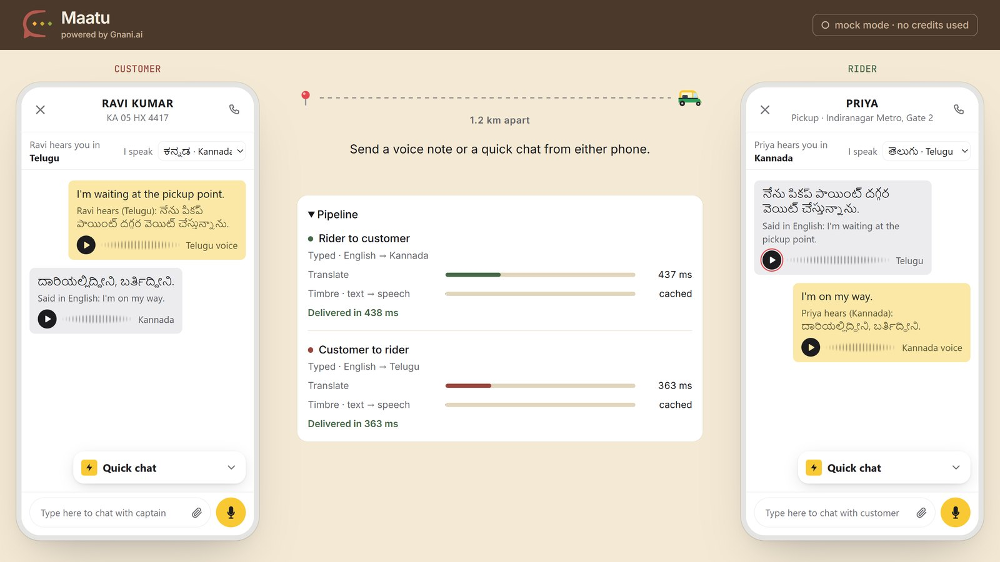
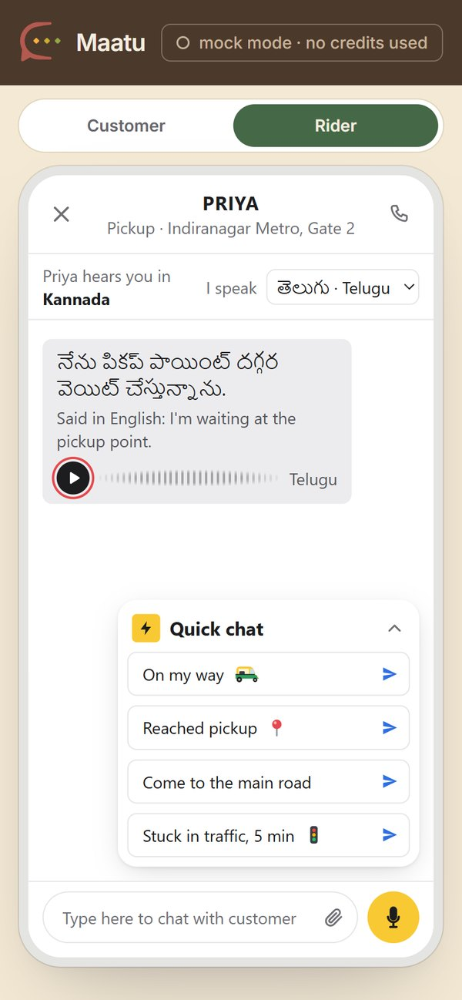

# Maatu, powered by Gnani

*Maatu (ಮಾತು) is Kannada for "talk". In Telugu it's maata (మాట). Same word, two languages.*

A ride-app customer speaks Kannada and the rider speaks Telugu. They send each other voice notes, and each one arrives **as speech and text in the listener's own language**. The rider hears the message instead of reading it on the bike.


Maatu is a **service that ride and delivery apps plug in**, not an app of its own. The app keeps its own chat and calls one endpoint. The two phones in the demo stand in for that app.

Built for the Great Indian AI Internship Challenge, on:

| Step | Service |
|---|---|
| Speech → text | **Gnani Prisma** v3.0 (v2.5 as a backup) |
| Translation | **Sarvam AI** Mayura |
| Text → speech | **Gnani Timbre** v2.5 |

## The demo

Send a voice note or a quick chat from either phone. It travels to the other phone, translated and spoken, and the pipeline in the middle shows how long each step took.



On a phone, the page shows one phone at a time. When a message lands, the other person's phone slides up, so you follow the conversation without scrolling.



## Run it

```bash
npm install
npm run dev        # mock mode: free, no keys needed
```

Then open http://localhost:4620.

Live mode makes real API calls and **spends credits**:

```bash
cp .env.example .env   # then add GNANI_API_KEY and SARVAM_API_KEY
npm run live
```

Each service goes live only when its key is set. `MAX_LIVE_CALLS` (default 40) caps the paid Gnani calls per run, and the chip in the top bar always shows whether you're in mock or live mode.

### Hosting

Maatu needs a server that stays running, because the two phones are connected through it (Socket.IO). Serverless hosts like Vercel or Netlify won't work. On Render, Railway or any VPS:

| Setting | Value |
|---|---|
| Build | `npm install` |
| Start | `npm run start:live` (or `npm start` for mock mode) |
| Environment | `GNANI_API_KEY`, `SARVAM_API_KEY`, `MAX_LIVE_CALLS` |

Phones only allow the microphone over `https://`, which these hosts provide.

## The API

```
POST /v1/voice-messages
x-api-key: <client key>
multipart: audio (wav/mp3/ogg/flac/aac/m4a, ≤ 30 s), from_lang, to_lang
```

```json
{
  "original_text": "ನಾನು ಗೇಟ್ ನಂಬರ್ 2 ಹತ್ತಿರ ನಿಂತಿದ್ದೀನಿ",
  "translated_text": "నేను గేట్ నంబర్ 2 దగ్గర నిలబడి ఉన్నాను",
  "audio_url": "/v1/audio/<hash>.wav",
  "fallback": false,
  "cached": { "translate": false, "tts": false },
  "timings_ms": { "stt": 212, "translate": 380, "tts": 301, "total": 897 }
}
```

Typed messages and quick chats ("Are you coming?") skip speech-to-text but still arrive as speech:

```
POST /v1/text-messages
x-api-key: <client key>
JSON: { "text": "Are you coming?", "from_lang": "en-IN", "to_lang": "te-IN" }
```

Language codes: `hi-IN kn-IN te-IN ta-IN ml-IN mr-IN bn-IN gu-IN pa-IN en-IN` (`GET /v1/languages`).

## How a message flows

```
voice note ─► Prisma (speech → text) ─► Sarvam (translate) ─► Timbre (text → speech) ─► listener
                  │                         │                      │
               queue                  queue + cache           queue + disk cache
```

## Built for scale

| Decision | Why |
|---|---|
| **Stateless endpoint** | No memory between requests, so you can run 10 copies behind a load balancer when traffic grows. |
| **A queue per outside service** (`src/limiter.js`) | Spikes wait in line instead of flooding Gnani with requests and hitting rate limits. When the line is too long, new work is refused early. |
| **Phrase cache** (`src/cache.js`, disk cache for speech) | "2 minutes" or "I'm at the gate" gets translated and spoken once, then reused instantly and for free. |
| **A second speech engine** (`src/providers/gnani.js`) | If Prisma v3.0 errors or times out, the same voice note goes to v2.5 before giving up. |
| **Never lose a message** (`src/pipeline.js`) | If a step fails, the listener still gets the best version available: translated text with the original voice, or just the original voice. |
| **Load test** (`npm run loadtest`) | Measures throughput and latency against mock providers that take as long as the real APIs. Refuses to run in live mode. |

In production you'd also move audio to object storage (S3 or similar), share the cache across instances (Redis), and delete audio after the ride for privacy (DPDP Act).

## Files

```
src/server.js         API routes + the demo chat relay
src/pipeline.js       speech → text → translation → speech, with fallbacks
src/providers/        gnani.js (Prisma, Timbre), sarvam.js (translation), bhashini.js and gemini.js (other translators), mock.js
src/limiter.js        per-service queue
src/cache.js          LRU cache
public/index.html     the first screen, the two-phone demo and the live pipeline timings
public/hero.js        the first screen's people and the "hello" that melts between scripts
public/phone.html     one phone (open /phone.html?role=rider&lang=te-IN on a real phone)
public/recorder.js    mic → 16 kHz WAV in the browser
scripts/loadtest.js   load test (mock mode only)
```

## License

MIT
